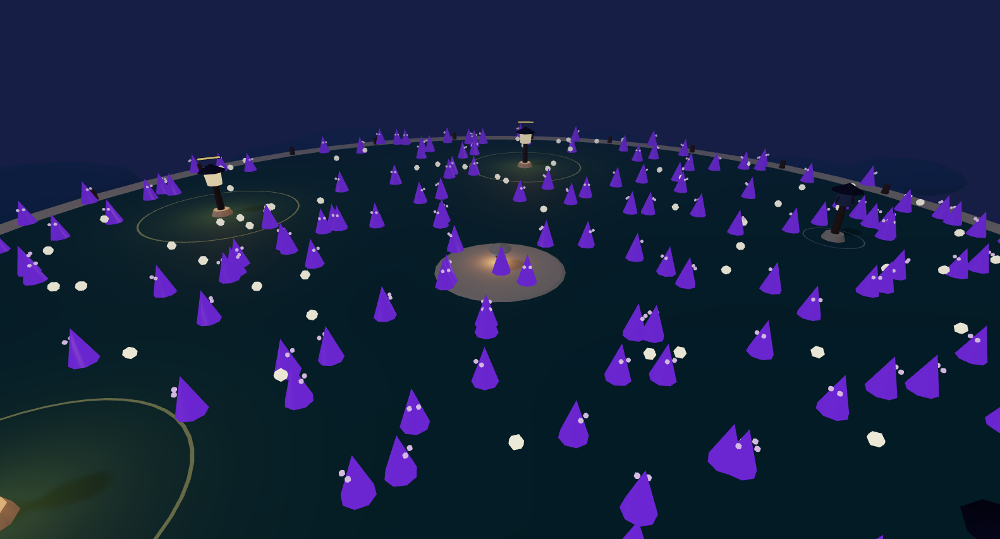

# Đảo Đèn Lồng — v1.0.0 (Contract v1.3)

> **Day 12 · AI SDLC Lab (Release `v1.0.0` · Tag `phase-4`)** · Sinh viên: **Ngô Đức Thịnh** (`2A202603548-NgoDucThinh`)
> 🎬 **Video demo (< 5 phút):** [`docs/demo/demo.mp4`](docs/demo/demo.mp4) *(và đính kèm trong GitHub Release `v1.0.0`)*



**Đảo Đèn Lồng** là trò chơi 3D góc nhìn thứ ba theo kiến trúc **Headless-First** (TypeScript + Three.js + Vite + Node.js), gồm chuỗi **3 Đêm (Đảo Bến · Đảo Cau · Đảo Chuông)** với cơ chế nhiên liệu đèn, Bóng Mực hút dầu, sức chứa tăng dần, bảng xếp hạng cục bộ, 4 nhóm tính năng dễ tiếp cận (Accessibility), chế độ benchmark 3D `100+ FPS` và chế độ soak/headless đạt chuẩn **Test Contract v1.3**.

---

## 1. Yêu cầu hệ thống

- **Hệ điều hành:** Windows 10/11, macOS hoặc Linux (x64 / arm64).
- **Runtime:** **Node.js `>= 20`** (`npm >= 10`).
- **Trình duyệt (để chơi & chạy `bench_cmd`):** Chrome, Chromium hoặc Microsoft Edge hỗ trợ WebGL2.
- **Phần cứng tham chiếu:** Đã kiểm chứng đạt `109.1 FPS` (`1% low: 67.2 FPS`) trên CPU Intel Core i5-11400H, GPU tích hợp Intel UHD Graphics, RAM 8 GB.

---

## 2. Cài đặt & Chạy game (Tối đa 3 lệnh)

Từ bản clone sạch của repository:

```bash
npm install
npm run build
node dist/run.js
```

Sau lệnh thứ 3, mở trình duyệt tại **`http://127.0.0.1:4173`** để chơi ngay (đã tích hợp sẵn lưu Bảng xếp hạng cục bộ vào đĩa).
*(Chế độ phát triển hot-reload: `npm run dev` tại `http://localhost:5173`.)*

### Chạy bằng Docker (Release `v1.0.0`)

```bash
docker build -t dao-den-long:1.0.0 .
docker run -p 4173:4173 dao-den-long:1.0.0
```

Mở **`http://localhost:4173`** trên trình duyệt.

---

## 3. Điều khiển & Dễ tiếp cận (Accessibility)

Mọi phím hành động đều có thể **đổi phím tùy ý** trong **Cài đặt → Đổi phím điều khiển** (có cảnh báo trùng phím, nút **"Khôi phục mặc định"**, lưu tự động qua `localStorage`):

| Hành động | Phím mặc định | Mô tả |
|---|---|---|
| Tiến / Lùi / Trái / Phải | `W` `S` `A` `D` (hỗ trợ `↑` `↓`) | Di chuyển (`6.0 m/s`; `7.2 m/s` khi có Bùa Gió) |
| Xoay camera & Zoom | Kéo chuột / `←` `→` · Cuộn chuột / `+` `-` / nút HUD | Xoay `cam_yaw_deg` & phóng to / thu nhỏ camera |
| Nhảy | `Space` | Nhảy (`7.0 m/s`, khi chạm đất) |
| Lướt (Dash) | `Shift` | `14.0 m/s` trong `0.2 s`, hồi chiêu `1.5 s`, giữ độ cao trên không |
| Tương tác | `E` (hoặc `F`) | Nạp ánh sáng (thắp mới `10`, thắp lại `5`) hoặc châm dầu (`+10` dầu/đom đóm) |
| Tỏa Sáng (Pulse) | `Q` | Tốn `3` đom đóm, bán kính 3D `5.0 m`, hồi chiêu `3.0 s` |
| Tạm dừng | `Esc` (hoặc `P`) | Đóng băng hoàn toàn logic mô phỏng, mở menu Tạm dừng |
| Tắt/bật âm thanh nhanh | `M` | Bật/tắt âm thanh WebAudio |

**Các tùy chọn Dễ tiếp cận tích hợp sẵn trong Cài đặt:**
- **Phụ đề & chỉ báo hình ảnh:** Hiện cảnh báo chữ rõ ràng kèm mũi tên chỉ hướng ở mép màn hình khi Bóng Mực xuất hiện, cảnh báo gió sắp thổi, đếm ngược `10 s` cuối và đèn sắp tắt (`fuel < 30`).
- **Giảm chuyển động (Reduce Motion):** Tắt hoàn toàn rung camera và hiệu ứng chớp màn hình khi bị đánh.
- **Cỡ chữ UI:** Tối thiểu `18 px` ở độ phân giải `1280×720`, có công tắc **Chữ lớn (`×1.25`)**.
- **Chế độ mù màu ("Bảng màu dễ phân biệt"):** Đổi Bóng Mực sang `#00B3FF`, cảnh báo sang `#FFFFFF` kèm biểu tượng `⚠`; đèn tắt luôn xẹp `20%` kèm vết rách.

---

## 4. Luật chơi & Bảng xếp hạng cục bộ

Mọi hằng số cân bằng được nạp từ [`game.contract.json`](game.contract.json):

| Đêm | Đảo | Thời lượng | Ngưỡng thắng lúc Bình Minh | Đặc trưng |
|---|---|---:|---:|---|
| **Đêm 1** | **Đảo Bến** | `240 s` | `≥ 3/5` đèn sáng | Đảo tròn `40 m`, rơi khỏi đảo (`Y < -10`) mất 1 Ngọn Lửa |
| **Đêm 2** | **Đảo Cau** | `270 s` | `≥ 4/6` đèn sáng | 2 đảo `28 m` + cầu tre + 2 Bục Nhảy + Bùa Gió + **Gió Lạc** |
| **Đêm 3** | **Đảo Chuông** | `300 s` | `≥ 5/7` đèn sáng | 3 tầng (`Y = 0/3/6`) + 2 dốc + Tháp Chuông + **Gió mạnh** mỗi `30 s` |

- **Bảng xếp hạng cục bộ:** Sau khi thắng Bình Minh Đêm 3 hoặc thua ở bất kỳ Đêm nào, người chơi nhập tên (`3–12` ký tự `[A-Za-z0-9_]` hoặc tiếng Việt có dấu) để lưu điểm xuống đĩa (`data/leaderboard.json`). Giữ Top 10, sắp xếp `score` giảm dần (bằng điểm ai đạt trước đứng trên). Xem trực tiếp tại nút **Bảng xếp hạng** ngoài Menu chính.
- **Xuất bảng xếp hạng qua CLI:**
  ```bash
  node dist/run.js --export-leaderboard out.json
  ```

---

## 5. Kiểm thử, Headless, Benchmark & Soak (Test Contract v1.3)

### 5.1. Bộ kiểm thử tự động đầy đủ (19 test: Phase 1–4)
```bash
npm run verify
```

### 5.2. Chạy mô phỏng Headless tất định (60 Hz)
```bash
node dist/headless.js --seed 42 --night 3 --ticks 1800 --snapshot-every 60 --out out.jsonl
```

### 5.3. Chạy Benchmark 3D (`1280×720`, 200 Bóng Mực + 100 Đom Đóm)
```bash
node dist/bench.js --seed 42 --duration 30 --out bench.json
```
- **Ghi chú về VSync:** Trình chạy benchmark tự động mở cửa sổ Chromium/Chrome/Edge kích thước `1280×720` (không toàn màn hình) với cờ `--disable-gpu-vsync` (`"vsync_off": true`) và khóa `pixelRatio = 1` ở chế độ chuẩn Đêm 1 (tắt toàn bộ nhân vật/skin sáng tạo).
- Kết quả tự đo được commit tại [`bench.json`](bench.json): **`avg_fps: 109.1`**, **`p1_low_fps: 67.2`**, **`frame_ms_p95: 14 ms`**, **`load_ms: 2002 ms`**.

### 5.4. Chạy Soak Test (10 Đêm liên tiếp trong cùng tiến trình)
```bash
node dist/soak.js --seed 7 --nights 10 --out soak.json
```
- Kết quả tự đo được commit tại [`soak.json`](soak.json): **`10 nights`**, **`crashes: 0`**, **`mem_start_mb: 38.1` → `mem_end_mb: 40.8`** (`1.07× <= 1.20×`), **`0.4 s`**.

---

## 6. Sáng tạo của tôi

Cô lập hoàn toàn trong `src/web/`, **tự động tắt trong cảnh benchmark và không ảnh hưởng đầu ra headless/soak**:
1. **Sảnh Chọn 4 Nhân Vật & 4 Chủ Đề Bản Đồ kèm Xem Trước 3D:** 4 nhân vật chi tiết (Mây mặc Áo Dài trắng Việt Nam, Linh mặc Hanbok, Mộc mặc đồ Tinh Linh, Sao mặc váy Công Chúa Băng Giá — tạo hình đường cong mềm mại bằng `LatheGeometry`, khuôn mặt, tóc, tay cầm lồng đèn) cùng 4 chủ đề bản đồ và 4 tạo hình ma riêng biệt.
2. **Zoom gần / Zoom xa mượt mà** (cuộn chuột, phím `+`/`-` và nút trên HUD).
3. **Âm thanh ngũ cung & SFX tổng hợp 100% bằng Web Audio API**, La bàn Ánh sáng 3D, mũi tên ngoài màn hình, thanh dầu 3D và hiệu ứng lá bay theo gió.

---

## 7. Tài liệu SDLC & Đóng gói

- [`game.contract.json`](game.contract.json) — Single Source of Truth (`contract_version: "1.3"`).
- [`bench.json`](bench.json) & [`soak.json`](soak.json) — Kết quả đo benchmark 30s & soak 10 đêm thực tế.
- [`docs/RETRO.md`](docs/RETRO.md) — Bản tổng kết Retrospective 4 phase (evaluation, lỗi AI, harness, token & cải tiến).
- [`EVIDENCE.md`](EVIDENCE.md) — Bằng chứng kiểm chứng đầy đủ cho cả 4 phase.
- [`CHANGELOG.md`](CHANGELOG.md) — Lịch sử thay đổi cả 4 phase (`v1.0.0`).
- [`docs/ADR-001-lantern-fuel-and-dawn-survival.md`](docs/ADR-001-lantern-fuel-and-dawn-survival.md) & [`docs/SPEC_PHASE2.md`](docs/SPEC_PHASE2.md).
- [`CREDITS.md`](CREDITS.md) & [`LICENSE`](LICENSE).
- [`AGENTS.md`](AGENTS.md) & [`.agents/skills/verify-contract/SKILL.md`](.agents/skills/verify-contract/SKILL.md).
